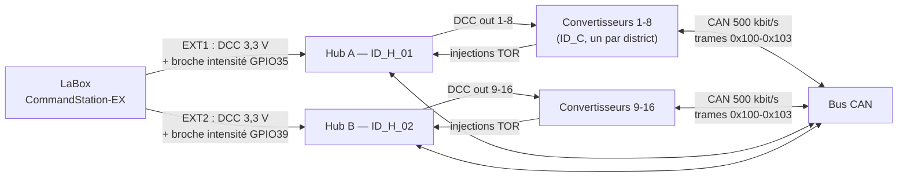

# 🔗 Liaison entre cartes — LaBox ↔ Hub ↔ Convertisseur (CFC)

Document d'interface de l'architecture DCC\_HUB\_DISTRIB-Booster : tout ce qui **concerne plusieurs cartes à la fois** — rôles, signaux partagés, timings coordonnés, réservations de protocole. Les README respectifs de chaque projet ne décrivent que leur propre carte.

## Vue d'ensemble de la chaîne



**Une seule modification de câblage par rapport au montage convertisseur-seul :** la ligne d'injection DAC (GPIO25 du convertisseur) ne va plus à la broche intensité de la LaBox — elle va au MCP23017 du hub du district. Le firmware du convertisseur reste inchangé.


| Hub   | Sortie LaBox | Injection DAC →         | Districts | Nom ID\_X\_nn                    |
| ----- | ------------ | ----------------------- | --------- | -------------------------------- |
| Hub A | EXT1         | GPIO35 (intensité EXT1) | 1…8       | **ID\_H\_01** (`HUB_INSTANCE` 0) |
| Hub B | EXT2         | GPIO39 (intensité EXT2) | 9…16      | **ID\_H\_02** (`HUB_INSTANCE` 1) |


Seule différence entre les deux cartes : la config (`Config.h`) — même firmware, même PCB.

## Commandes utiles à la recette (par carte)


| Commande                       | Carte         | Ce qu'elle montre                                                               |
| ------------------------------ | ------------- | ------------------------------------------------------------------------------- |
| `watch` / `watch json`         | hub           | tous les modules vus sur le bus (`ID_H_xx`, `ID_C`, `ID_B_xx`), état, `[STALE]` |
| `districts` / `districts json` | hub           | état des 8 districts du hub                                                     |
| `hub`                          | hub           | identité (A/B, EXT1/EXT2, ID\_H\_xx, version)                                   |
| `cut N` / `on N`               | hub           | coupure / réactivation manuelle d'un district                                   |
| `inject on / off`              | hub           | test de l'injection DAC vers la LaBox                                           |
| `boosters` / `boosters json`   | convertisseur | modules aval vus par le convertisseur — doit afficher les `ID_H_xx` (TYPE=5)    |


## Nomenclature commune ID\_X\_nn (trame 0x102)


| TYPE  | Lettre  | Nom                       | Cartes                                 | Firmware                  |
| ----- | ------- | ------------------------- | -------------------------------------- | ------------------------- |
| 0     | `C`     | `ID_C`                    | Convertisseur DCC → CAN (unique)       | DCC\_CAN\_RMT-Booster     |
| 1     | `B`     | `ID_B_01`…`ID_B_nn`       | Boosters de puissance                  | boosters aval             |
| 2     | `S`     | `ID_S_nn`                 | Aiguillages / accessoires (réservé)    | futures cartes            |
| 3     | `D`     | `ID_D_nn`                 | Détection d'occupation (réservé)       | futures cartes            |
| **5** | **`H`** | **`ID_H_01` / `ID_H_02`** | **Hubs de distribution (EXT1 / EXT2)** | DCC\_HUB\_DISTRIB-Booster |


Le type 4 reste libre. Chaque type garde son espace de 254 numéros — un octet par trame de télémétrie (\~0,2 % de charge bus).

**Réservation requise côté convertisseur** : `BoosterWatch` doit reconnaître TYPE=5 (lettre `H`) pour que `boosters` affiche les hubs comme les `ID_B_xx` :

```
> boosters
ID_B_01  OK       vu il y a 12 ms
ID_B_02  FAULT    vu il y a 8 ms  [DEFAUT CONFIRME]
ID_H_01  OK       vu il y a 340 ms
ID_H_02  OFF      vu il y a 210 ms
```

## Répartition des responsabilités (niveaux de défaut)


| Niveau | Acteur          | Action                                               | Portée                  |
| ------ | --------------- | ---------------------------------------------------- | ----------------------- |
| 1      | booster (ID\_B) | coupe sa propre zone                                 | 1 zone                  |
| 1.5    | **hub (ID\_H)** | lit l'injection TOR du district, coupe son DCC out   | 1 district              |
| 2      | **hub**         | retry du district (5 s, 10 s)                        | 1 district              |
| 3      | **hub** → LaBox | injection DAC sur la broche intensité de **son** EXT | 1 segment (8 districts) |


Le convertisseur garde son rôle de **confirmation** (3 trames FAULT consécutives → injection) et son **failsafe** (DCC perdu &gt; 500 ms → `BOOSTER_OFF` + relâchement) : ce sont eux qui referment la boucle du niveau 1.5. Ne pas modifier ces comportements sans recaler les paramètres hub ci-dessous.

## Timings coordonnés


| Paramètre              | Valeur         | Chez qui      | Coordination                                                                                  |
| ---------------------- | -------------- | ------------- | --------------------------------------------------------------------------------------------- |
| Failsafe DCC           | 500 ms         | convertisseur | le hub coupe le DCC du district ; c'est ce délai qui fait relâcher l'injection                |
| Confirmation défaut    | 3 trames FAULT | convertisseur | \~3 s : le hub ne voit l'injection qu'après, le niveau 1 a déjà eu le temps d'agir            |
| `INJECT_CONFIRM_MS`    | 20 ms          | hub           | anti-rebond, « au maintien d'injection du convertisseur                                       |
| `INJECT_RELEASE_MS`    | 50 ms          | hub           | le convertisseur met &gt; 500 ms à relâcher : le hub attend un front bas stable               |
| `RETRY_DELAY1/2_MS`    | 5 s / 10 s     | hub           | deux essais avant verrouillage                                                                |
| `LOCK_TO_GLOBAL_MS`    | 30 s           | hub           | le niveau 3 n'arrive qu'en dernier recours                                                    |
| Backoff rétablissement | 40 ms → 10 s   | LaBox         | le hub relâche son injection quand tout revient OK : les deux mécanismes se réarment ensemble |
| `DAC_INJECT_VALUE`     | 235 (\~3,04 V) | hub           | seuil LaBox = 2500 mA ÷ 0,80 = 2,52 V ; recalculer si le facteur de shunt LaBox change        |


## Configuration LaBox — `config.Labox.h`


| Action | Détail |
| --- | --- |
| **Activer les 2 sorties booster** | `#define YOUR_MOTOR_SHIELD_TYPE LABOX_MAIN_BOOSTER_BOOSTER_MOTOR_SHIELD` → EXT1 et EXT2 en sorties « Booster » indépendantes, une par hub |
| **Polarité des deux EXT** | vérifier une fois à l'oscillo que EXT1 et EXT2 sont en phase ; sinon `#define INVERT_BOOSTER_OUTPUT` |
| **Facteur de shunt 0,80** | ne pas le modifier sans recalculer `DAC_INJECT_VALUE` côté hub |
| **RailCom** | si `ENABLE_LABOX_RAILCOM` est activé, le GPIO Matrix du hub transporte le cutout intact jusqu'aux convertisseurs ; les boosters aval le régénèrent comme aujourd'hui |
| **Lecture d'intensité EXT** | inutilisable (elle voit l'injection du hub en niveau 3) — sans importance, la sortie EXT n'alimente que le hub |
| **Commandes par piste** | DCC-EX `<1>`/`<0>` reste possible par EXT (coupe EXT1 sans toucher EXT2) |


## Signaux entre cartes


| Signal            | De → Vers                                     | Format                           | Remarques                                            |
| ----------------- | --------------------------------------------- | -------------------------------- | ---------------------------------------------------- |
| DCC               | LaBox EXT → hub GPIO27                        | 0–3,3 V via XOR SN74LVC1G86      | masse commune obligatoire                            |
| DCC (copies)      | hub → convertisseurs                          | 0–3,3 V, fronts d'origine        | même format que EXT, vers les XOR des convertisseurs |
| Injection TOR     | convertisseur GPIO25 → hub MCP23017           | \~3,04 V = défaut, via 4,7–10 kΩ | ne va **plus** à la LaBox                            |
| Injection repli   | hub GPIO25 (DAC) → broche intensité EXT LaBox | \~3,04 V via 4,7–10 kΩ           | jamais &gt; 3,3 V                                    |
| Télémétries       | toutes cartes → bus CAN                       | 0x102 DLC 5                      | ID + TYPE + état                                     |
| Bits DCC / cutout | convertisseur → boosters                      | 0x100 / 0x101                    | inchangé, hors périmètre hub                         |


## Ordre de mise sous tension (recommandé)

1. **Bus CAN** sous tension — hubs et convertisseurs démarrent, `watch`/`boosters` s'emplit (`ID_H_xx`, `ID_C`, `ID_B_xx`) ;
2. **LaBox** — EXT1/EXT2 émettent le DCC → convertisseurs sortent du failsafe → districts vivants ;
3. **Défaut d'un district** — la chaîne locale (booster → convertisseur → hub) agit sans jamais solliciter la LaBox, sauf défaut persistant (niveau 3, 1 seul segment sur 2).

## Checklist de recette (première mise en service)

- [ ] `watch` (hub) / `boosters` (convertisseur) : tous les modules présents, pas de `[STALE]`, `ID_H_01` **et** `ID_H_02` affichés ;
- [ ] `districts` : les 8 districts `ACTIF` sur chaque hub ;
- [ ] `cut 3` puis `on 3` : le district 3 seul est coupé, LED bleue ;
- [ ] court-circuit volontaire sur un district : niveaux 1 puis 1.5, les autres districts (des deux hubs) vivants ;
- [ ] `inject on` : \~3,04 V sur GPIO25, LaBox coupe **son** segment, l'autre hub continue ; `inject off` : rétablissement automatique ;
- [ ] oscillo sur le district le plus éloigné : fronts DCC propres, cutout intact.

## Cahier des charges de compatibilité (résumé)

**LaBox** : shield à 2 boosters, phase EXT1/EXT2 vérifiée, facteur 0,80 stable.  
**Convertisseur** : TYPE=5 réservé dans `BoosterWatch`, injection recâblée vers le hub, failsafe 500 ms et confirmation 3 trames inchangés.  
**Hub** : GPIO Matrix actif, MCP23017 sur interruption, timings du tableau ci-dessus, télémétrie ID\_H\_xx DLC 5, `HubWatch` tolérant DLC 4 (anciens boosters).