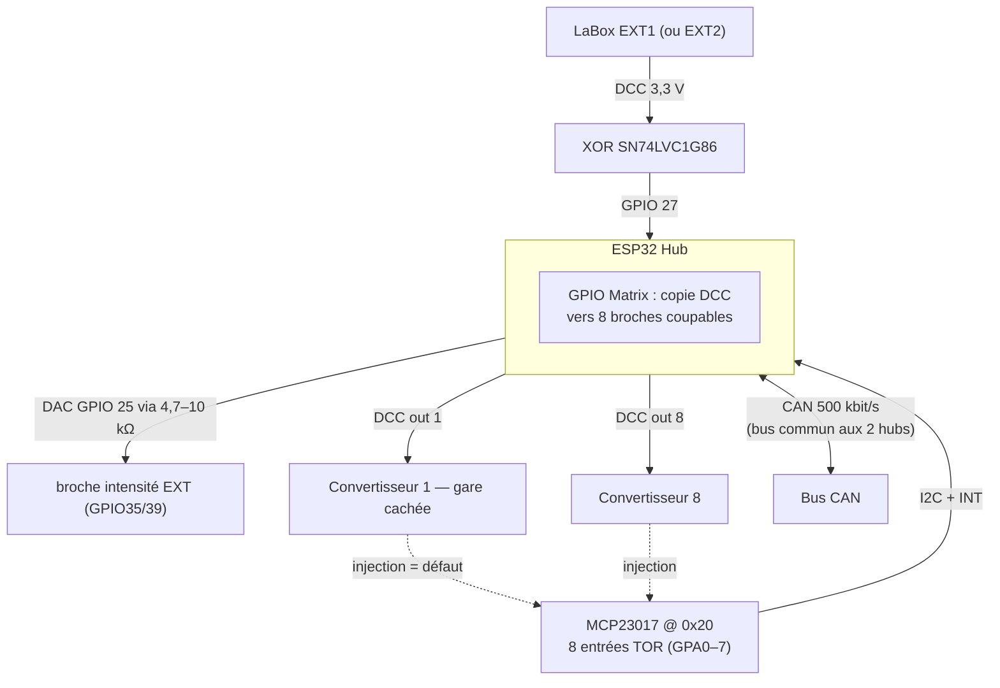
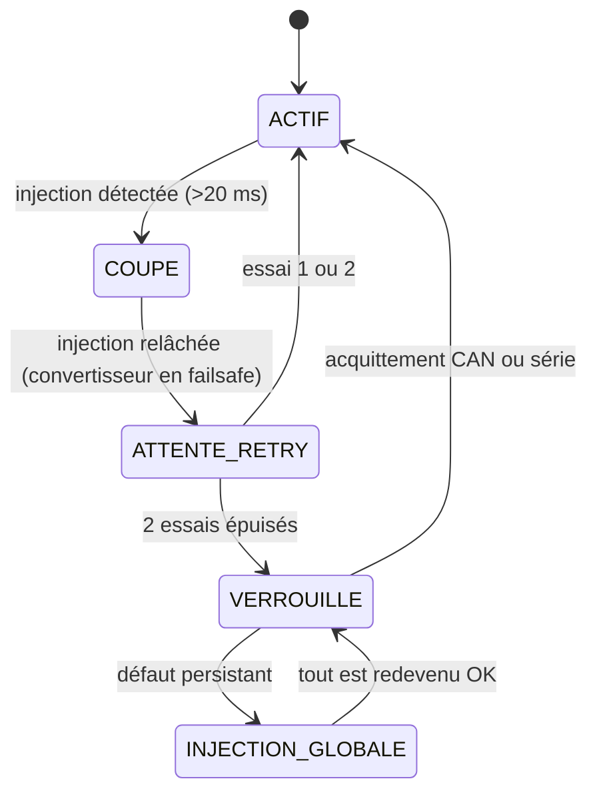
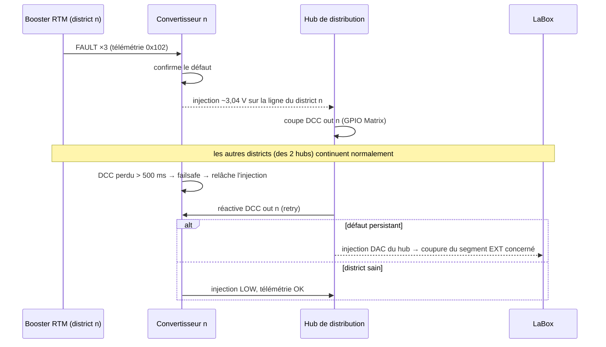

# 🚂 Hub de distribution DCC — CFC (2 × 8 districts)

Carte ESP32 intermédiaire entre **une sortie EXT de la LaBox** et **8 convertisseurs DCC\_CAN\_RTM-Booster** (un par district). Chaque district dispose d'une sortie DCC 3,3 V **coupable individuellement** et d'une entrée « intensité » TOR (ligne d'injection du convertisseur). Les convertisseurs et boosters existants restent **inchangés**.

**Deux hubs identiques** — l'un sur EXT1, l'autre sur EXT2 — donnent **16 districts au total**, chacun avec son repli global indépendant :


| Hub   | Sortie LaBox | Injection DAC →         | Districts | Nom ID\_X\_nn                    |
| ----- | ------------ | ----------------------- | --------- | -------------------------------- |
| Hub A | EXT1         | GPIO35 (intensité EXT1) | 1…8       | **ID\_H\_01** (`HUB_INSTANCE` 0) |
| Hub B | EXT2         | GPIO39 (intensité EXT2) | 9…16      | **ID\_H\_02** (`HUB_INSTANCE` 1) |


### Nomenclature ID\_X\_nn — les hubs entrent dans la famille

Extension du tableau du DCC\_CAN\_RTM-Booster : **TYPE=5 → lettre `H`**, nommage `ID_H_01`…`ID_H_02` reconstruit côté convertisseur (et supervision PC) comme pour les boosters. À réserver dans le firmware convertisseur :


| TYPE  | Lettre  | Nom                     | Cartes                               |
| ----- | ------- | ----------------------- | ------------------------------------ |
| 0     | `C`     | `ID_C`                  | Convertisseur DCC → CAN (unique)     |
| 1     | `B`     | `ID_B_01`…`ID_B_nn`     | Boosters de puissance                |
| 2     | `S`     | `ID_S_nn`               | Aiguillages / accessoires (réservé)  |
| 3     | `D`     | `ID_D_nn`               | Détection d'occupation (réservé)     |
| **5** | **`H`** | **`ID_H_01`…`ID_H_nn`** | **Hubs de distribution (EXT1/EXT2)** |


⚠️ Les types 2/3 étant réservés à des cartes futures, le type 4 reste libre — on saute directement à 5 pour les hubs afin de garder 4 disponible. Chaque type garde son espace de 254 numéros.

Seule différence entre les deux cartes : la config (`Config.h`) — même firmware, même PCB.

## Principe : DCC direct sur GPIO (8 districts)

Avec 8 districts, l'ESP32 a assez de broches : le **GPIO Matrix** recopie le signal DCC d'entrée vers les **8 broches DCC out**, une par district (fronts d'origine, zéro charge CPU). Couper un district = déconnecter sa broche de la matrice et la forcer à 0. Les injections TOR des convertisseurs arrivent sur un **MCP23017** (I2C, 8 entrées, interruption). Pas de 74HC126, pas de 2ᵉ MCP23017.

## Architecture (par hub)



## Brochage ESP32 (commun aux 2 hubs)


| Fonction              | GPIO     | Rôle / câblage                                                    |
| --------------------- | -------- | ----------------------------------------------------------------- |
| DCC in (hub)          | 27       | EXT → XOR SN74LVC1G86 → GPIO27, masse commune LaBox ↔ hub         |
| DCC out 1             | 13       | vers XOR du convertisseur 1                                       |
| DCC out 2             | 14       | vers XOR du convertisseur 2                                       |
| DCC out 3             | 15       | vers XOR du convertisseur 3                                       |
| DCC out 4             | 18       | vers XOR du convertisseur 4                                       |
| DCC out 5             | 19       | vers XOR du convertisseur 5                                       |
| DCC out 6             | 16       | vers XOR du convertisseur 6                                       |
| DCC out 7             | 17       | vers XOR du convertisseur 7                                       |
| DCC out 8             | 32       | vers XOR du convertisseur 8                                       |
| Injection hub → LaBox | 25 (DAC) | résistance 4,7–10 kΩ → GPIO35 (hub A) ou GPIO39 (hub B), ≈ 3,04 V |
| I2C SDA / SCL         | 21 / 22  | MCP23017 @ 0x20, 400 kHz                                          |
| INT MCP23017          | 34       | pull-up 10 kΩ externe, active bas                                 |
| CAN TX / RX           | 5 / 4    | TWAI natif 500 kbit/s, transceiver TJA1050/SN65HVD230             |
| LED WS2812            | 26       | 9 LED (1 générale + 8 districts), 100 nF près du strip            |


GPIO 33 et les entrées 35/36/39 restent libres (l'entrée 35/39 est utilisée côté LaBox, pas côté hub).

## Entrées intensité — MCP23017

- **GPA0…GPA7** = injections des districts 1…8 du hub ;
- ligne d'injection du convertisseur (son GPIO25) → résistance série 4,7–10 kΩ → GPIO du MCP23017 ;
- niveaux : `HIGH` ≈ 3,04 V = défaut confirmé, `LOW` = normal — lisible en TOR, aucun ADC nécessaire ;
- lecture **par interruption** (broche INT → GPIO34), confirmation anti-rebond ≥ 20 ms ;
- pull-ups internes du MCP : ligne lue `LOW` si un convertisseur est absent (pas de faux défaut).

## Logique à niveaux


| Niveau | Qui agit | Effet |
| --- | --- | --- |
| 1 — local | chaque booster (via CAN) | coupe sa propre zone, trafic continu ailleurs |
| 1.5 — **hub** | hub de distribution | injection du district n détectée → **coupe DCC out n** (broche déconnectée de la matrice, forcée à 0). Le convertisseur n perd son DCC &gt; 500 ms → failsafe → relâche son injection. **Aucun autre district touché.** |
| 2 — retry | hub | réactivation du district après délai (5 s puis 10 s), 2 essais |
| 3 — repli global | hub | si le défaut revient : district verrouillé + **injection DAC du hub vers la broche intensité de SON EXT** → la LaBox coupe uniquement ce segment (EXT1 ou EXT2), l'autre hub et ses 8 districts continuent normalement |


Avec deux hubs, le repli global ne coupe plus que la **moitié** du réseau — c'est le double avantage d'EXT1 + EXT2 par rapport à un hub de 16.

## Machine à états d'un district



## Séquence de coupure sélective



## Câblage des convertisseurs (inchangé)

Chaque convertisseur se branche **comme sur EXT1/EXT2** :


| Signal convertisseur             | Destination               | Remarque                                                 |
| -------------------------------- | ------------------------- | -------------------------------------------------------- |
| entrée DCC (via son XOR, GPIO27) | DCC out n du hub          | même format que EXT LaBox                                |
| injection DAC (GPIO25)           | entrée TOR du MCP23017    | résistance 4,7–10 kΩ, la ligne ne va **plus** à la LaBox |
| CAN TX/RX                        | bus CAN commun aux 2 hubs | supervision 0x102 côté hubs                              |
| masse                            | masse commune hub/LaBox   | obligatoire, déjà imposée par le CAN                     |


⚠️ Chaque convertisseur appartient à un hub précis : les 8 premiers sur le hub A (EXT1), les 8 suivants sur le hub B (EXT2). La nomenclature ID\_B\_xx reste globale sur le bus CAN (B\_01 à B\_16).

## Nomenclature (BOM) — par hub (×2)


| Élément                              | Qté                          |
| ------------------------------------ | ---------------------------- |
| ESP32 DevKitC (WROOM-32)             | 1                            |
| XOR SN74LVC1G86                      | 1                            |
| MCP23017 (DIP/SOIC)                  | 1                            |
| Résistance 4,7–10 kΩ                 | 9 (8 injections + 1 DAC)     |
| Pull-up 10 kΩ (INT)                  | 1                            |
| Transceiver CAN (TJA1050/SN65HVD230) | 1                            |
| Strip WS2812                         | 9 LED (1 + 8)                |
| Résistances 120 Ω                    | 2 par bus CAN (terminaisons) |
| Borniers 3 pts (DCC, GND, inj.)      | 8                            |


## Commandes série du hub

```
districts          état des 8 districts (état, dernier défaut, retries)
districts json     idem JSON pour supervision PC
cut N / on N       coupure / réactivation manuelle d'un district
inject on|off      test de l'injection DAC vers la LaBox
hub                identité du hub (EXT1/EXT2, ID CAN)
reset              redémarrage ESP32
```

## Structure du firmware (miroir de DCC\_CAN\_RMT-Booster)

```
src/
├── Pins.h            broches et adresses I2C
├── Config.h          seuils, délais, IDs CAN, identité du hub (A ou B)
├── DistrictRouter.h/.cpp      copie GPIO Matrix + coupure directe par broche
├── InjectionInput.h/.cpp     MCP23017 : lecture des 8 injections (INT)
├── DistrictManager.h/.cpp     machine à états des 8 districts
├── GlobalInject.h/.cpp        DAC → broche intensité de l'EXT du hub
├── HubCanConfig.h             Provider CanUniversal (TWAI interne, TX=5/RX=4)
├── CanHub.h/.cpp              télémétrie 0x102 + écoute du bus (ID_B_xx)
├── StatusLed.h/.cpp           WS2812 : 1 LED générale + 8 districts
├── Cli.h/.cpp                 commandes série
└── main.cpp                   setup + boucle
```